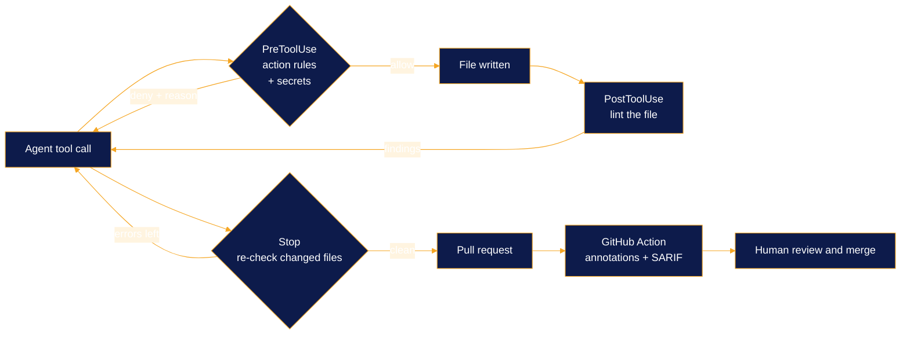

<p align="center">
  
</p>

<h3 align="center">Lint your marketing like you lint your code.</h3>

<p align="center">
  Claude Code hooks, a CLI and a GitHub Action that stop AI agents from shipping the business, legal and
  house-style mistakes code linters never look at.
</p>

<p align="center">
  <a href="https://github.com/chris-fountoulis/agency-guardrails/actions/workflows/ci.yml"></a>
  <a href="https://github.com/chris-fountoulis/agency-guardrails/tags"></a>
  <a href="LICENSE"></a>
  <a href="pyproject.toml"></a>
  <a href="pyproject.toml"></a>
  <br>
  <a href="https://growthofinfluence.com"></a>
  <a href="https://chrisfountoulis.com"></a>
</p>

<p align="center">
  <a href="#30-second-quickstart">Quickstart</a> ·
  <a href="#features">Rules</a> ·
  <a href="#claude-code">Claude Code</a> ·
  <a href="#github-action">GitHub Action</a> ·
  <a href="#configuration">Config</a> ·
  <a href="#methodology">Methodology</a> ·
  <a href="docs/rules.md">Rule reference</a>
</p>

A conditional "free" offer. A price with no VAT-inclusive figure. A client named without consent. A secret in a
draft. A hotfix pushed straight to the production server. agency-guardrails catches each of these before it
ships, whether the author is an AI agent or a person. Built by [Chris Fountoulis](https://chrisfountoulis.com) at
[Growth Of Influence](https://growthofinfluence.com), where it runs on the agency's own content and site code.

> [!WARNING]
> **Not legal advice.** agency-guardrails is engineering tooling. Its rules are heuristics that make an agent, and
> then a person, stop and look before content ships. Passing them does not make copy compliant and failing one
> is not a legal finding.

## Contents

- [Demo](#demo)
- [30-second quickstart](#30-second-quickstart)
- [Why this exists](#why-this-exists)
- [Features](#features)
- [How it works](#how-it-works)
- [Claude Code](#claude-code)
- [GitHub Action](#github-action)
- [Configuration](#configuration)
- [Methodology](#methodology)
- [Roadmap](#roadmap)
- [Contributing](#contributing)
- [License](#license)
- [About](#about)

## Demo

<p align="center">
  
</p>

<details open>
<summary><b>Plain-text output</b></summary>

This is the real output of `guardrails check examples/site/bad/bakery-website-speed.html`:

```text
examples/site/bad/bakery-website-speed.html
  5:3      warn   GR-SEO-002  Focus keyword 'bakery website speed' is missing from the title
  6:3      warn   GR-SEO-002  Focus keyword 'bakery website speed' is missing from the meta description
  12:3     warn   GR-SEO-001  Opening paragraph starts with filler ('in today's'): lead with the answer
  18:29    error  GR-STY-001  Banned character U+2014 (em dash) written as &mdash;
  18:83    warn   GR-STY-002  Banned phrase 'utilize': use 'use'
  19:3     error  GR-EU-004   'Northwind Fitness' is named but has no consent record in consent/approved.txt
  20:3     error  GR-EU-004   Image appears to show 'Northwind Fitness' (logo or photo) without a consent record
  20:3     error  GR-SEO-004  Image /images/northwind-fitness-logo.png has no alt text
  23:12    error  GR-EU-001   'free' appears next to a payment or condition (only pay): a conditional free claim
  23:45    error  GR-EU-002   Price €15 has no VAT-inclusive figure next to it; at 24% VAT show €18.60 incl. VAT
  24:23    error  GR-EU-003   '99.9% uptime' promises an uptime percentage
  24:40    error  GR-EU-003   '24/7' promises 24/7 availability
  24:67    error  GR-EU-003   'guaranteed' promises a guarantee
  25:15    warn   GR-SEO-005  Link to https://web.dev/articles/vitals opens a new tab without rel="noopener"
  27:3     warn   GR-SEO-003  FAQ section 'FAQ' has no FAQPage JSON-LD

1 file checked, 9 errors, 6 warnings
```

</details>

Inside Claude Code the same findings reach the agent the moment it wirtes the file, and a risky command never runs:

```json
{
  "hookSpecificOutput": {
    "hookEventName": "PreToolUse",
    "permissionDecision": "deny",
    "permissionDecisionReason": "agency-guardrails blocked this Bash call:\n- GR-DEP-001 (error): BLOCKED: scp copies files onto a protected target (deploy@prod.example.com:/srv/www/acme-bakery/public_html/). Make the change on a branch and open a pull request; let the reviewed merge deploy it. ..."
  }
}
```

## 30-second quickstart

```bash
pipx install git+https://github.com/chris-fountoulis/agency-guardrails   # or: pip install git+https://...
git clone https://github.com/chris-fountoulis/agency-guardrails && cd agency-guardrails
guardrails check examples/site/bad      # a page an agent wrote: exits 1 with findings
guardrails check examples/site/fixed    # the same page, fixed: exits 0
```

In your own project:

```bash
guardrails init          # writes a commented guardrails.toml and a consent registry
guardrails check .       # text, --format json, --format sarif or --format github
echo "Our new offer" | guardrails check --stdin-filename draft.md -   # check text before it is a file
```

> [!TIP]
> Run `guardrails explain GR-EU-002` for the rationale, the fix and the primary source of any rule, right in the
> terminal.

## Why this exists

At [Growth Of Influence](https://growthofinfluence.com) AI agents write and ship a lot of content and site code:
articles, landing pages , offers, pricing tables, deploys. Code has linters , type checkers and CI. Copy had a
human reviewer who was not always in the loop.

The rules in this repository came from real near misses in that production work:

| Near miss | What could have gone wrong | Rule that now catches it |
| --- | --- | --- |
| An agent-written offer described a website build as "free" while a monthly hosting plan paid for it | EU consumer law lists this as unfair in all circumstances | `GR-EU-001` |
| A price shown to consumers with no VAT-inclusive figure next to it | Consumer price rules require the final price | `GR-EU-002` |
| An agent "fixed" a page by editing the production server directly | The repository and the live site drifted apart | `GR-DEP-001` to `003` |

Each became a written house rule, then a hook, then a rule pack. The pricing logic behind the first case is the
kind of thing agencies publish on a page like our [website hosting plans](https://growthofinfluence.com/website-hosting/),
where one careless word changes the legal meaning of the offer.

The public Claude Code hook collections we found enforce code rules (formatting, tests , dangerous shell
commands). None of them enforce the business and legal rules of the content itself. That is the gap this fills.

## Features

| Pack | Rules | Catches |
| --- | --- | --- |
| `eu-marketing` | GR-EU-001 to 004 | Conditional "free" claims (Directive 2005/29/EC, Annex I point 20), prices without a VAT-inclusive figure with a configurable VAT rate and a consistency check (Directive 98/6/EC), uptime SLA, guarantee and 24/7 wording, client names or logos without an entry in your consent registry |
| `aeo-seo` | GR-SEO-001 to 005 | Answer in the first 50 to 70 words, focus keyword in title, H1, first paragraph and meta description, FAQ sections with matching FAQPage JSON-LD, image alt text, `target=_blank` without `rel="noopener"` |
| `house-style` | GR-STY-001 to 002 | Banned characters (em and en dash by default, including `&mdash;` entities) and banned words with suggested replacements; quotations are exempt so a quote is never silently edited |
| `secrets` | GR-SEC-001 to 003 | AWS, GitHub, Anthropic, OpenAI, Stripe, Slack and Google tokens, private key blocks, high-entropy values assigned to credential names; `guardrails redact` scrubs them from any text |
| `deploy-safety` | GR-DEP-001 to 003 | scp, rsync, ssh and local writes to protected hosts or paths, edits to protected files, force pushes and direct pushes to protected branches; every block says "open a pull request" |

Every rule carries a rationale, a fix and a citation to the primary source. See the full
[rule reference](docs/rules.md) or run `guardrails explain GR-EU-002`. The `aeo-seo` pack encodes the same
answer-first structure we track across the vendors in our
[AI search optimization market map](https://growthofinfluence.com/ai-search-optimization-companies/).

<details>
<summary><b>More features</b></summary>

- **Offset-exact findings** for HTML and Markdown: markup, code blocks , URLs and front-matter keys are ignored,
  entities are decoded and every finding points at the original line and column.
- **Three ways to silence a finding:** `[[guardrails.ignore]]` by path, `guardrails-ignore: GR-XXX reason` on a
  line, or `guardrails-ignore-file: GR-XXX` for a file.
- **Outputs:** text, JSON, SARIF 2.1.0 for code scanning , GitHub annotations for pull requests.
- **Custom rules** as plain Python classes, loaded with `plugins = ["my_rules.py"]`. See
  [writing rules](docs/writing-rules.md).
- **Zero dependencies.** Standard library only, Python 3.9 to 3.13, with a built-in TOML fallback for 3.9 and 3.10.

</details>

## How it works



One engine, one config, four entry points : the CLI, the three Claude Code hooks , the GitHub Action and a
pre-commit hook. A rule written once runs in all of them.

## Claude Code

Install as a plugin (needs `python3` 3.9+ on the PATH, nothing else):

```text
/plugin marketplace add chris-fountoulis/agency-guardrails
/plugin install agency-guardrails@agency-guardrails
```

Or in one step from a terminal: `claude plugin install agency-guardrails --marketplace chris-fountoulis/agency-guardrails`.

<details>
<summary><b>Or wire the CLI into <code>.claude/settings.json</code></b></summary>

```json
{
  "hooks": {
    "PreToolUse": [{ "matcher": "Bash|Write|Edit|MultiEdit|NotebookEdit",
                     "hooks": [{ "type": "command", "command": "guardrails hook pre-tool-use" }] }],
    "PostToolUse": [{ "matcher": "Write|Edit|MultiEdit|NotebookEdit",
                      "hooks": [{ "type": "command", "command": "guardrails hook post-tool-use" }] }],
    "Stop": [{ "hooks": [{ "type": "command", "command": "guardrails hook stop" }] }]
  }
}
```

</details>

| Hook | Answers with |
| --- | --- |
| `PreToolUse` | `permissionDecision: "deny"` and a reason the model reads |
| `PostToolUse` | `decision: "block"` for errors, `additionalContext` for warnings |
| `Stop` | `decision: "block"` while errors remain; honours `stop_hook_active` |

> [!NOTE]
> On their own errors the hooks exit 1 and fail open: a broken config shows up in the transcript instead of
> freezing a working session. Details in [docs/claude-code.md](docs/claude-code.md).

## GitHub Action

```yaml
- uses: actions/checkout@v7
- uses: chris-fountoulis/agency-guardrails@v0.1.0
  with:
    paths: content site
    upload-sarif: "true"   # needs permissions: security-events: write
```

Findings appear as annotations on the pull request diff and as a table in the job summary. See
[docs/github-action.md](docs/github-action.md) and [examples/workflow.yml](examples/workflow.yml).

## Configuration

`guardrails init` writes a commented starter. The essentials:

```toml
[guardrails]
packs = ["eu-marketing", "aeo-seo", "house-style", "secrets", "deploy-safety"]
disable = ["GR-SEO-001"]
fail_on = "error"

[[guardrails.ignore]]
path = "legal/**"
rules = ["GR-STY-*"]

[eu-marketing]
vat_rate = 24
watch_names = ["Acme Bakery"]             # names to watch; nothing is hardcoded
consent_registry = "consent/approved.txt" # one approved name per line

[house-style]
banned_chars = ["\u2014", "\u2013"]       # escapes, so the config itself stays clean
banned_words = ["utilize => use"]

[deploy-safety]
protected_hosts = ["prod.example.com"]
protected_globs = ["dist/**"]
block_direct_push = true

[rules.GR-EU-002]
severity = "warn"
```

> [!IMPORTANT]
> Unknown keys, packs, rules and options are rejected with the list of valid ones. A typo in `guardrails.toml`
> fails loudly instead of silently switching a rule off.

The config is discovered by walking up from the first path checked (`guardrails.toml`, `.guardrails.toml` or
`guardrails.json`).

## Methodology

How the rules were built and how we know they work. The full write-up is in
[docs/methodology.md](docs/methodology.md).

| Question | Answer |
| --- | --- |
| Where do the rules come from? | Real near misses in agent-written content and deploys at Growth Of Influence, each one written down as a house rule before it became code |
| What backs each rule? | A primary source: EU directives on EUR-Lex, Google Search Central, W3C WCAG, the WHATWG HTML standard, NIST, OWASP, MITRE CWE and GitHub docs. The registry refuses a rule without an https citation |
| How is each rule tested? | Positive and negative tests for every rule, plus a sample site that must fail in `bad/` and pass in `fixed/` |
| Where does it run? | CI on Python 3.9, 3.10, 3.11, 3.12 and 3.13, the GitHub Action run both ways on the sample site and the CLI checking this repository on every push |
| What are the limits? | Pattern heuristics in English, not a legal review. A clean run means no rule matched |

## Roadmap

- Publish to PyPI so `pipx install agency-guardrails` works without a git URL.
- A `--baseline` file, so a large existing site can adopt the rules without fixing every old page first.
- Autofix for the mechanical findings (banned characters, `rel="noopener"`, VAT-inclusive figures).
- Phrase lists for more EU languages in the `eu-marketing` pack, starting with Greek , German and French.
- A `--changed` mode that checks only the lines a pull request touches.

## Contributing

Issues and pull requests are welcome, especially false positives (with the smallest text that triggers them) and
new rules with a primary source. Read [CONTRIBUTING.md](CONTRIBUTING.md) and the
[Code of Conduct](CODE_OF_CONDUCT.md). Report security issues privately as described in [SECURITY.md](SECURITY.md).

## License

[MIT](LICENSE). Engineering tooling, not legal advice.

## About

agency-guardrails is built and maintained by [Chris Fountoulis](https://chrisfountoulis.com), founder of
[Growth Of Influence](https://growthofinfluence.com), a digital marketing agency in Thessaloniki. AI agents write
the first draft there and these guardrails decide what reaches a human reviewer. If you want to run the same
setup in your own agency, [book a call](https://growthofinfluence.com/meeting).

<p align="center">
  
</p>

<p align="center">
  Built by <a href="https://chrisfountoulis.com">Chris Fountoulis</a> at
  <a href="https://growthofinfluence.com">Growth Of Influence</a> ·
  <a href="https://github.com/chris-fountoulis">GitHub</a>
</p>
