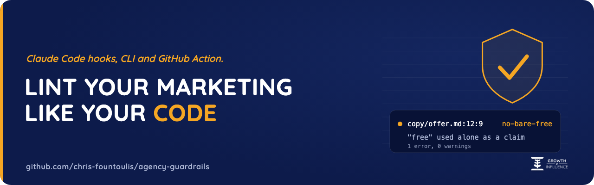
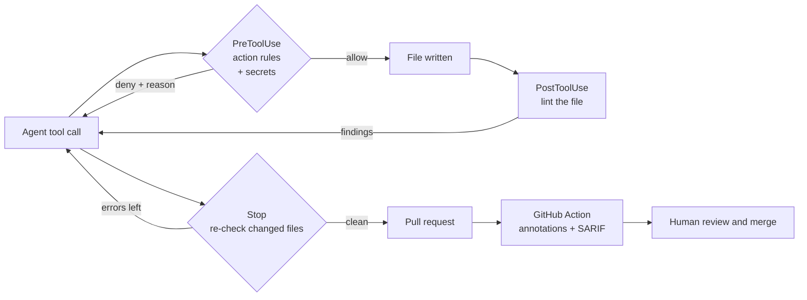

<p align="center">
  
</p>

# agency-guardrails

**Lint your marketing like you lint your code.** Claude Code hooks, a CLI and a GitHub Action that stop AI agents
from shipping the business, legal and house-style mistakes that code linters never look at: a conditional "free"
offer, a price with no VAT-inclusive figure, a client named without consent, a secret in a draft, a hotfix pushed
straight to the production server.

[](https://github.com/chris-fountoulis/agency-guardrails/actions/workflows/ci.yml)
[](LICENSE)
[](https://github.com/chris-fountoulis/agency-guardrails/tags)
[](pyproject.toml)
[](pyproject.toml)

> **Not legal advice.** agency-guardrails is engineering tooling. Its rules are heuristics that make an agent, and
> then a person, stop and look before content ships. Passing them does not make copy compliant, and failing one
> is not a legal finding.

## 30-second quickstart

```bash
pipx install git+https://github.com/chris-fountoulis/agency-guardrails   # or: pip install git+https://...
git clone https://github.com/chris-fountoulis/agency-guardrails && cd agency-guardrails
guardrails check examples/site/bad      # a page an agent wrote: exits 1 with findings
guardrails check examples/site/fixed    # the same page, fixed: exits 0
```

In your own project:

```bash
guardrails init          # writes a commented guardrails.toml and a consent registry
guardrails check .       # text, --format json, --format sarif or --format github
```

## Demo

This is the real output of `guardrails check examples/site/bad/bakery-website-speed.html`:

```text
examples/site/bad/bakery-website-speed.html
  5:3      warn   GR-SEO-002  Focus keyword 'bakery website speed' is missing from the title
  6:3      warn   GR-SEO-002  Focus keyword 'bakery website speed' is missing from the meta description
  12:3     warn   GR-SEO-001  Opening paragraph starts with filler ('in today's'): lead with the answer
  18:29    error  GR-STY-001  Banned character U+2014 (em dash) written as &mdash;
  18:83    warn   GR-STY-002  Banned phrase 'utilize': use 'use'
  19:3     error  GR-EU-004   'Northwind Fitness' is named but has no consent record in consent/approved.txt
  20:3     error  GR-EU-004   Image appears to show 'Northwind Fitness' (logo or photo) without a consent record
  20:3     error  GR-SEO-004  Image /images/northwind-fitness-logo.png has no alt text
  23:12    error  GR-EU-001   'free' appears next to a payment or condition (only pay): a conditional free claim
  23:45    error  GR-EU-002   Price €15 has no VAT-inclusive figure next to it; at 24% VAT show €18.60 incl. VAT
  24:23    error  GR-EU-003   '99.9% uptime' promises an uptime percentage
  24:40    error  GR-EU-003   '24/7' promises 24/7 availability
  24:67    error  GR-EU-003   'guaranteed' promises a guarantee
  25:15    warn   GR-SEO-005  Link to https://web.dev/articles/vitals opens a new tab without rel="noopener"
  27:3     warn   GR-SEO-003  FAQ section 'FAQ' has no FAQPage JSON-LD

1 file checked, 9 errors, 6 warnings
```

Inside Claude Code the same findings reach the agent the moment it writes the file, and a risky command never runs:

```json
{
  "hookSpecificOutput": {
    "hookEventName": "PreToolUse",
    "permissionDecision": "deny",
    "permissionDecisionReason": "agency-guardrails blocked this Bash call:\n- GR-DEP-001 (error): BLOCKED: scp copies files onto a protected target (deploy@prod.example.com:/srv/www/acme-bakery/public_html/). Make the change on a branch and open a pull request; let the reviewed merge deploy it. ..."
  }
}
```

## Why this exists

At [Growth Of Influence](https://growthofinfluence.com), a digital marketing agency, AI agents write and ship a
lot of content and site code: articles, landing pages, offers, pricing tables, deploys. Code has linters, type
checkers and CI. Copy had a human reviewer who was not always in the loop.

The rules in this repository came from real near misses in that production work:

- an agent-written offer that described a website build as "free" while a monthly hosting plan paid for it, which
  EU consumer law lists as unfair in all circumstances;
- a price shown to consumers with no VAT-inclusive figure next to it;
- an agent that "fixed" a page by editing the production server directly, so the repository and the live site
  drifted apart.

Each became a written house rule, then a hook, then a rule pack. The public Claude Code hook collections we found enforce code
rules (formatting, tests, dangerous shell commands). None of them enforce the business and legal rules of the
content itself. That is the gap this fills.

## Features

| Pack | Rules | Catches |
| --- | --- | --- |
| `eu-marketing` | GR-EU-001 to 004 | Conditional "free" claims (Directive 2005/29/EC, Annex I point 20), prices without a VAT-inclusive figure with a configurable VAT rate and a consistency check (Directive 98/6/EC), uptime SLA, guarantee and 24/7 wording, client names or logos without an entry in your consent registry |
| `aeo-seo` | GR-SEO-001 to 005 | Answer in the first 50 to 70 words, focus keyword in title, H1, first paragraph and meta description, FAQ sections with matching FAQPage JSON-LD, image alt text, `target=_blank` without `rel="noopener"` |
| `house-style` | GR-STY-001 to 002 | Banned characters (em and en dash by default, including `&mdash;` entities) and banned words with suggested replacements; quotations are exempt so a quote is never silently edited |
| `secrets` | GR-SEC-001 to 003 | AWS, GitHub, Anthropic, OpenAI, Stripe, Slack and Google tokens, private key blocks, high-entropy values assigned to credential names; `guardrails redact` scrubs them from any text |
| `deploy-safety` | GR-DEP-001 to 003 | scp, rsync, ssh and local writes to protected hosts or paths, edits to protected files, force pushes and direct pushes to protected branches; every block says "open a pull request" |

Every rule carries a rationale, a fix and a citation to the primary source. See the full
[rule reference](docs/rules.md) or run `guardrails explain GR-EU-002`.

Also:

- **Offset-exact findings** for HTML and Markdown: markup, code blocks, URLs and front-matter keys are ignored,
  entities are decoded, and every finding points at the original line and column.
- **Three ways to silence a finding:** `[[guardrails.ignore]]` by path, `guardrails-ignore: GR-XXX reason` on a
  line, or `guardrails-ignore-file: GR-XXX` for a file.
- **Outputs:** text, JSON, SARIF 2.1.0 for code scanning, GitHub annotations for pull requests.
- **Custom rules** as plain Python classes, loaded with `plugins = ["my_rules.py"]`. See
  [writing rules](docs/writing-rules.md).
- **Zero dependencies.** Standard library only, Python 3.9 to 3.13, with a built-in TOML fallback for 3.9 and 3.10.

## How it works



One engine, one config, four entry points: the CLI, the three Claude Code hooks, the GitHub Action and a
pre-commit hook. A rule written once runs in all of them.

## Claude Code

Install as a plugin (needs `python3` 3.9+ on the PATH, nothing else):

```text
/plugin marketplace add chris-fountoulis/agency-guardrails
/plugin install agency-guardrails@agency-guardrails
```

On Claude Code 2.1.275 or later, in one step: `/plugin install agency-guardrails --marketplace chris-fountoulis/agency-guardrails`.

Or wire the CLI into `.claude/settings.json`:

```json
{
  "hooks": {
    "PreToolUse": [{ "matcher": "Bash|Write|Edit|MultiEdit|NotebookEdit",
                     "hooks": [{ "type": "command", "command": "guardrails hook pre-tool-use" }] }],
    "PostToolUse": [{ "matcher": "Write|Edit|MultiEdit|NotebookEdit",
                      "hooks": [{ "type": "command", "command": "guardrails hook post-tool-use" }] }],
    "Stop": [{ "hooks": [{ "type": "command", "command": "guardrails hook stop" }] }]
  }
}
```

The hooks follow the Claude Code hooks contract: PreToolUse answers with `permissionDecision: "deny"` and a reason,
PostToolUse with `decision: "block"` (errors) or `additionalContext` (warnings), Stop with `decision: "block"` and
honours `stop_hook_active`. On their own errors they exit 1 and fail open. Details in
[docs/claude-code.md](docs/claude-code.md).

## GitHub Action

```yaml
- uses: actions/checkout@v4
- uses: chris-fountoulis/agency-guardrails@v0.1.0
  with:
    paths: content site
    upload-sarif: "true"   # needs permissions: security-events: write
```

Findings appear as annotations on the pull request diff and as a table in the job summary. See
[docs/github-action.md](docs/github-action.md) and [examples/workflow.yml](examples/workflow.yml).

## Configuration

`guardrails init` writes a commented starter. The essentials:

```toml
[guardrails]
packs = ["eu-marketing", "aeo-seo", "house-style", "secrets", "deploy-safety"]
disable = ["GR-SEO-001"]
fail_on = "error"

[[guardrails.ignore]]
path = "legal/**"
rules = ["GR-STY-*"]

[eu-marketing]
vat_rate = 24
watch_names = ["Acme Bakery"]             # names to watch; nothing is hardcoded
consent_registry = "consent/approved.txt" # one approved name per line

[house-style]
banned_chars = ["\u2014", "\u2013"]       # escapes, so the config itself stays clean
banned_words = ["utilize => use"]

[deploy-safety]
protected_hosts = ["prod.example.com"]
protected_globs = ["dist/**"]
block_direct_push = true

[rules.GR-EU-002]
severity = "warn"
```

The config is discovered by walking up from the first path checked (`guardrails.toml`, `.guardrails.toml` or
`guardrails.json`). Unknown keys, packs, rules and options are rejected with the list of valid ones.

## Roadmap

- Publish to PyPI so `pipx install agency-guardrails` works without a git URL.
- A `--baseline` file, so a large existing site can adopt the rules without fixing every old page first.
- Autofix for the mechanical findings (banned characters, `rel="noopener"`, VAT-inclusive figures).
- Phrase lists for more EU languages in the `eu-marketing` pack, starting with Greek, German and French.
- A `--changed` mode that checks only the lines a pull request touches.

## Contributing

Issues and pull requests are welcome, especially false positives (with the smallest text that triggers them) and
new rules with a primary source. Read [CONTRIBUTING.md](CONTRIBUTING.md) and the
[Code of Conduct](CODE_OF_CONDUCT.md). Report security issues privately as described in [SECURITY.md](SECURITY.md).

## License

[MIT](LICENSE). Engineering tooling, not legal advice.

---

Built by [Chris Fountoulis](https://github.com/chris-fountoulis) at [Growth Of Influence](https://growthofinfluence.com),
where AI agents write the first draft and these guardrails decide what reaches a human reviewer.
