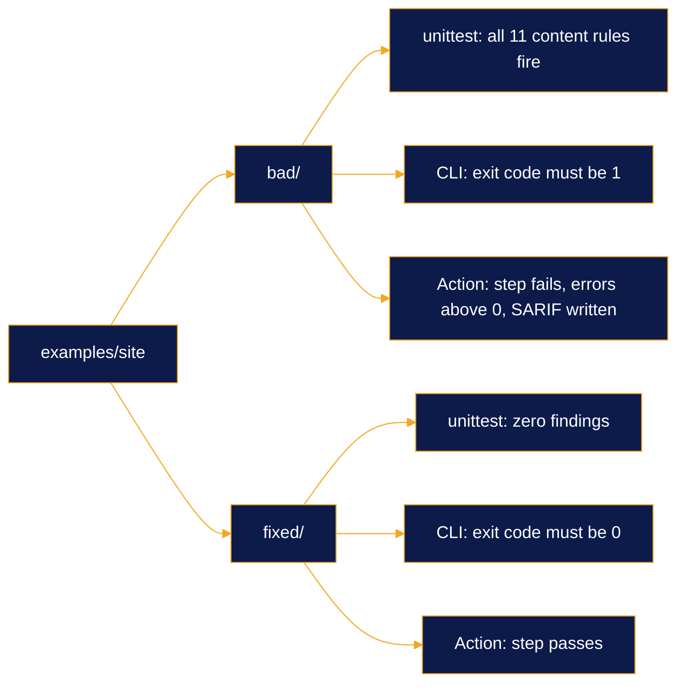

# Methodology

[Back to README](../README.md)

How the rules in agency-guardrails were chosen, where each one comes from and how we know the code does what the
rule says. It also lists what the project does not do, which matters as much for a tool that touches legal
wording.

> [!WARNING]
> **Not legal advice.** Every rule here is an engineering heuristic. A rule cites the law or guideline that
> motivated it so a reader can check the source. It never decides whether a piece of copy is lawful.

## Contents

- [Where the rules come from](#where-the-rules-come-from)
- [Primary sources](#primary-sources)
- [How every rule is tested](#how-every-rule-is-tested)
- [The example site contract](#the-example-site-contract)
- [Continuous integration](#continuous-integration)
- [Dogfooding](#dogfooding)
- [Limits](#limits)

## Where the rules come from

The rules started as written house rules at [Growth Of Influence](https://growthofinfluence.com), a digital
marketing agency where AI agents draft articles, landing pages, offers and site changes every week. Each rule
exists because something shipped or nearly shipped:

| What happened or nearly happened | House rule it became | Rule id |
| --- | --- | --- |
| A website build described as "free" while a monthly hosting plan paid for it | Say what is covered and what it costs, never a bare "free" next to a condition | `GR-EU-001` |
| A consumer price with no VAT-inclusive figure | Show the final price next to every price | `GR-EU-002` |
| Draft sales copy with uptime and 24/7 wording the terms of service did not back | No uptime percentage, no guarantee, no 24/7 promise | `GR-EU-003` |
| A client name about to go on a public page with no written consent on file | No client name or logo without a consent record | `GR-EU-004` |
| An agent fixing a page by editing the production server directly | Production changes only through a reviewed pull request | `GR-DEP-001` to `003` |
| Em dashes and stock phrases in agent drafts | A short list of banned characters and words | `GR-STY-001`, `GR-STY-002` |
| Articles that buried the answer below an introduction | Answer the question in the first 50 to 70 words | `GR-SEO-001` |

The path was the same each time. A person caught the mistake in review. The fix went into a written rule.
Agents kept missing the written rule, so it became a Claude Code hook. The hook logic was then generalised into
the rule packs in this repository: client names, hosts and paths became configuration and nothing
agency-specific stayed in the code.

> [!NOTE]
> We copy mechanisms, not facts. The packs ship with no client names, no hosts and no brand words. You add your
> own in `guardrails.toml` and the consent registry.

## Primary sources

Every rule cites a primary source: the directive, the standard or the official documentation. Blog posts and
summaries do not count. The registry enforces it: `@register` rejects a rule that has no title, no rationale or a
citation that is not an https URL, so an undocumented rule cannot load. This table is the citation field of every
rule in the registry, the same list `guardrails rules` prints.

| Rule | What it checks | Primary source |
| --- | --- | --- |
| `GR-EU-001` | Conditional "free" claim | [Directive 2005/29/EC](https://eur-lex.europa.eu/eli/dir/2005/29/oj) (Unfair Commercial Practices), Annex I point 20 |
| `GR-EU-002` | Price without a VAT-inclusive figure | [Directive 98/6/EC](https://eur-lex.europa.eu/eli/dir/1998/6/oj) (consumer price indication) |
| `GR-EU-003` | Uptime SLA, guarantee or 24/7 wording | [Directive 2005/29/EC](https://eur-lex.europa.eu/eli/dir/2005/29/oj), Article 6 misleading actions |
| `GR-EU-004` | Client name or logo without a consent record | [Directive 2005/29/EC](https://eur-lex.europa.eu/eli/dir/2005/29/oj), Annex I point 4 endorsement claims |
| `GR-SEO-001` | Answer in the first 50 to 70 words | [Google Search Central: AI features](https://developers.google.com/search/docs/appearance/ai-features) |
| `GR-SEO-002` | Focus keyword in title, H1, first paragraph and meta description | [Google Search Central: SEO starter guide](https://developers.google.com/search/docs/fundamentals/seo-starter-guide) |
| `GR-SEO-003` | FAQ section without matching FAQPage JSON-LD | [Google Search Central: FAQPage structured data](https://developers.google.com/search/docs/appearance/structured-data/faqpage) |
| `GR-SEO-004` | Image without alt text | [W3C WCAG 2.1, 1.1.1 Non-text Content](https://www.w3.org/WAI/WCAG21/Understanding/non-text-content.html) |
| `GR-SEO-005` | `target=_blank` link without `rel="noopener"` | [WHATWG HTML: link type noopener](https://html.spec.whatwg.org/multipage/links.html#link-type-noopener) |
| `GR-STY-001` | Banned character | [Unicode General Punctuation chart](https://www.unicode.org/charts/PDF/U2000.pdf) |
| `GR-STY-002` | Banned word or phrase | [Google developer documentation style guide: word list](https://developers.google.com/style/word-list) |
| `GR-SEC-001` | Provider API key or token | [GitHub secret scanning: supported patterns](https://docs.github.com/en/code-security/secret-scanning/introduction/supported-secret-scanning-patterns) |
| `GR-SEC-002` | Private key block | [OWASP Secrets Management Cheat Sheet](https://cheatsheetseries.owasp.org/cheatsheets/Secrets_Management_Cheat_Sheet.html) |
| `GR-SEC-003` | Hard-coded secret assignment | [MITRE CWE-798](https://cwe.mitre.org/data/definitions/798.html) |
| `GR-DEP-001` | Direct write to a protected host or path | [NIST SP 800-53 Rev. 5](https://csrc.nist.gov/pubs/sp/800/53/r5/upd1/final), configuration change control |
| `GR-DEP-002` | Edit to a protected file | [GitHub docs: protected branches](https://docs.github.com/en/repositories/configuring-branches-and-merges-in-your-repository/managing-protected-branches/about-protected-branches) |
| `GR-DEP-003` | Push straight to a protected branch | [GitHub docs: protected branches](https://docs.github.com/en/repositories/configuring-branches-and-merges-in-your-repository/managing-protected-branches/about-protected-branches) |

The rationale and fix text for each rule are in the generated [rule reference](rules.md). The answer-first
structure behind the `aeo-seo` pack is also what we measured across the vendors in the
[AI search optimization market map](https://growthofinfluence.com/ai-search-optimization-companies/).

## How every rule is tested

The test suite is plain `unittest` with no third-party packages. It runs with:

```bash
python3 -m unittest discover -s tests -t .
```

| Layer | What it proves | Where |
| --- | --- | --- |
| Positive tests | The rule fires on text that breaks it, at the right line and column | `tests/test_<pack>.py` |
| Negative tests | The rule stays quiet on near misses: quotations, code blocks, URLs, markup, allowed phrases, read-only commands | `tests/test_<pack>.py` |
| Registry tests | A bad id or a missing citation is rejected, every registered rule is documented | `tests/test_registry.py` |
| Hook contract tests | Each Claude Code hook answers with the documented JSON and fails open on bad input or a bad config | `tests/test_hooks.py` |
| Output tests | Text, JSON, SARIF 2.1.0 and GitHub annotation formats | `tests/test_output.py` |
| Generated docs | `docs/rules.md` matches the registry byte for byte | `tests/test_plugin.py`, `scripts/gen_rules_doc.py --check` |

> [!TIP]
> Test strings that look like credentials are assembled at runtime from fragments in `tests/fakes.py`. The
> repository never holds a literal token, so secret scanners have nothing to flag and the secrets pack can still
> be tested against realistic shapes.

## The example site contract

`examples/site/` holds the same two pages twice. `bad/` is what an agent wrote. `fixed/` is the version a reviewer
would approve. The tests treat both as a contract:

- `bad/` must trigger every content rule in the `eu-marketing`, `aeo-seo` and `house-style` packs, all 11 of them,
  and nothing else.
- `fixed/` must produce zero findings across both files.

A change that makes a rule miss its example or fire on the fixed copy fails the build. CI then checks the same
pair a second time through the CLI and a third time through the GitHub Action.



## Continuous integration

[`.github/workflows/ci.yml`](../.github/workflows/ci.yml) runs on every push to `main` and every pull request,
with `permissions: contents: read`.

| Job | Steps |
| --- | --- |
| `test` (matrix: Python 3.9, 3.10, 3.11, 3.12, 3.13) | Install the package, run the unit tests, check `docs/rules.md` is current, CLI smoke test on `examples/site/fixed` (must pass) and `examples/site/bad` (must fail), dogfood on the repository, scan every text file for em and en dashes |
| `action` | Run the composite action from the checkout on `examples/site/fixed` (must pass) and on `examples/site/bad` (must fail with a nonzero error count and a SARIF file) |

The matrix runs on `ubuntu-24.04` because it is the last runner image that still ships Python 3.9. The TOML
fallback for 3.9 and 3.10 is tested against `tomllib` on the versions that have it.

## Dogfooding

The repository checks itself. The root [`guardrails.toml`](../guardrails.toml) enables the `house-style`,
`secrets` and `deploy-safety` packs for the whole tree, excluding only `examples/site/bad/`, which is wrong on
purpose. CI runs `guardrails check .` on every push, so the README, the docs and the code comments follow the
same no-dash rule the tool enforces. The marketing packs are off for the repository because the docs quote the
very phrases those rules exist to catch.

## Limits

> [!IMPORTANT]
> Read these before relying on a green check.

- **Heuristics, not legal review.** The `eu-marketing` rules match patterns that often signal a problem. They
  cannot read intent, context outside the file or the terms of the actual offer. A person still owns what ships.
- **English phrase lists.** The built-in phrases for "free", conditions and guarantees are English. Copy in other
  languages needs its own lists through configuration or a plugin.
- **VAT is a configured rate.** `GR-EU-002` checks for an inclusive figure at the `vat_rate` you set (24 by
  default). It does not know which rate applies to your product or country.
- **A consent registry is a text file.** `GR-EU-004` checks that a name appears in your registry. Whether you
  hold valid written consent is up to you.
- **Deploy safety parses commands.** `GR-DEP-001` to `003` read shell commands and file paths. A determined
  bypass (an alias, a script written first and run second) can get past them. Treat them as a seatbelt for honest
  mistakes and keep server-side protection such as protected branches in place.
- **Fails open on its own errors.** A hook that crashes or cannot read its config exits 1 and lets the session
  continue, by design. Run `guardrails check` in CI as well if you need a hard stop.
- **No published precision figure.** We have not measured a false-positive rate across a public corpus. False
  positive reports with the smallest triggering text are the most useful issue you can open.

[Back to README](../README.md)

---

Built by [Chris Fountoulis](https://chrisfountoulis.com) at [Growth Of Influence](https://growthofinfluence.com).
